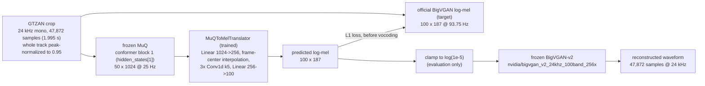

# muq-inversion

An interpretability experiment: can recognizable music audio be recovered from the time-resolved hidden
states of a frozen music encoder, [MuQ](https://arxiv.org/abs/2501.01108)
(`OpenMuQ/MuQ-large-msd-iter`)?

The current pipeline (TASK-15 onward) trains only a small **translator**:



- **Frozen:** MuQ and the [BigVGAN-v2](https://arxiv.org/abs/2206.04658) vocoder.
  - BigVGAN is never in the training graph: the loss compares mel spectrograms before vocoding.
  - No discrete quantizer codes are traversed. MuQ's RVQ is used only for its pretraining targets.
- **Data:** 2-second crops of GTZAN; genre labels are metadata only.
- **MuQ representation:**
  - TASK-15 to TASK-21 used the final output (`last_hidden_state`).
  - TASK-22 onward uses the output of the first conformer block, which a fixed decoder recovers much more easily.

This replaces the project's original plans, which are kept in `notes/DECISIONS.md` as prior evidence:

- a HiFi-GAN-style waveform decoder;
- translators into frozen DAC and EnCodec codec latents (TASK-01 to TASK-14).

The full write-up of the BigVGAN line, with every tensor shape, rate and alignment convention, is in
**`reports/task26_pipeline_report/main.pdf`** (TASK-26).

`CLAUDE.md` holds the reproducibility rules and working protocol. Its scope section still describes the
earlier EnCodec pipeline.

## Results so far (through TASK-25)

Every number below is direct mel L1 in nats, the training loss, on one training seed. For reference, BigVGAN's
own round trip (true mel → audio → mel) scores about 0.11 on every set. That is a different quantity, not a
floor.

**Unseen tracks** (identical evaluation crops; best checkpoint chosen on val):

| Task | MuQ input; training data | val | test | val2 | test2 |
| --- | --- | --- | --- | --- | --- |
| TASK-18 | last layer; 32 tracks | 0.576 | 0.525 | 0.557 | 0.586 |
| TASK-19 | last layer; 128 tracks | 0.513 | 0.490 | 0.510 | 0.517 |
| TASK-20 | last layer; 512 tracks, early stopping | 0.475 | 0.465 | 0.481 | 0.494 |
| TASK-21 | last layer; 512 tracks, 47 h of training | 0.455 | 0.454 | 0.473 | 0.480 |
| TASK-22 | **first block**; 512 tracks | **0.260** | **0.257** | **0.260** | **0.263** |

**Fixed training crops** (fitting diagnostics on the TASK-22 representation):

| Task | Setting | Training-set fit | Unseen-track monitoring (16 crops) |
| --- | --- | --- | --- |
| TASK-23 | one crop | 0.020 | — |
| TASK-24 | N = 1 / 4 / 16 / 64 / 256 crops | 0.0002 / 0.041 / 0.095 / 0.174 / 0.243 | 1.34 / 1.13 / 0.66 / 0.44 / 0.31 |
| TASK-25 | N = 256: best optimizer settings / 2× width | 0.167–0.170 / 0.145 | 0.36–0.375 / 0.364 (vs 0.308 for the worst-fitting arm) |

### What has been established

- **Memorization works.**
  - A few crops are memorized well below the round-trip level (TASK-15/16).
  - One crop reaches 0.020 (TASK-23).
  - Informal listening found no difference from vocoding the true mel.
- **Unseen tracks are recognizable but well below the oracle.**
  - Every model beats shuffled and constant-input controls.
  - Blinded listening (TASK-19/20) rated the reconstructions recognizable but well below the oracle.
  - The 4–10% gains from more data were not audible.
- **Representation depth matters a lot.** Under the same translator and recipe, first-block features lower
  unseen-track error by about 43% compared with the last layer (TASK-22). This shows greater recoverability with
  this decoder, not that deeper layers discard information. Blinded listening of TASK-22 is still pending.
- **Fitting many examples is the bottleneck now.** Training error rises steeply with the number of fixed crops
  (TASK-24). With 512 tracks, training and unseen-track errors are almost equal (TASK-22: 0.255 vs 0.26).
- **Optimization and width help fitting, but not unseen tracks.**
  - Learning rate and batch size interact (TASK-25).
  - Doubling the width gives the best fit.
  - A learned temporal resampler is worth only 0.003.
  - Lower training error came with higher unseen-track error.
  - The arms sound nearly the same.

### Open questions

- Is the remaining error a matter of capacity, optimization, or an ambiguous mapping from features to mel?
- Why does better fitting not transfer to unseen tracks?
- Which mel errors are audible? Predictions are measurably smoother over time than the targets.
- Variability across training seeds has not been measured.

None of these results establishes an information ceiling, invertibility, or non-invertibility. See the
TASK-26 report (Sections 6–7) for the full synthesis and the discriminating next experiments.

## Where things are

| Path | Contents |
| --- | --- |
| `tasks/TASK-NN.md` | Verbatim task briefs |
| `notes/DECISIONS.md` | Protocol and result entry per task, plus corrections |
| `notes/MEMORY.md` | Verified durable facts |
| `notes/NEXT.md` | Current status and the next command to run |
| `configs/taskNN*.yaml` | All tunable settings (`*_smoke.yaml` for bounded smoke runs) |
| `src/muq_inversion/` | Package code, notably `bigvgan_common.py` (BigVGAN loading, official mel, floor), `time_alignment.py` (frame-center alignment), `models/muq_mel_translator.py`, `device.py`, `wandb_logging.py`, `taskNN.py` helpers |
| `scripts/` | Entry points: `train_task18_heldout.py` (the shared TASK-18 to TASK-22 trainer), `task23_overfit.py`, `task24_ladder.py`, `task25_ablation.py`, `taskNN_analyze.py`, listening-package builders |
| `aces/` | ACES (TAMU, Intel PVC) Slurm jobs, smoke scripts and `TASKNN_ACES.md` runbooks |
| `reports/task26_pipeline_report/` | Synthesis report: LaTeX source, figures, inspection scripts |
| `data/manifests/` | Tracked split and crop manifests, with the Sturm (2013) GTZAN fault list |
| `artifacts/`, `runs/`, `data/raw`, `data/cache`, `third_party/` | Git-ignored outputs, checkpoints, audio, feature caches, BigVGAN code |

## Setup

```bash
uv sync --frozen
uv run python scripts/fetch_bigvgan.py      # one time per machine: official BigVGAN code + weights at a pinned revision (~450 MB) into third_party/
uv run pytest -q
uv run ruff check .
```

GTZAN audio must be at `data/raw/gtzan/genres/<genre>/<genre>.NNNNN.wav`. Gate 0/1 checks:

```bash
uv run python -m muq_inversion.cli doctor --config configs/smoke.yaml
uv run python -m muq_inversion.cli prepare-data --config configs/smoke.yaml
```

## Running experiments

Every task has its own config, script and smoke test. Smoke runs disable W&B; full runs log to W&B, with
one group per task and one run per arm, and keep a local JSONL mirror. Examples:

```bash
# TASK-15/16 memorization (BigVGAN oracle, then N = 2 or 8)
uv run python scripts/task15_bigvgan_oracle.py --device mps
uv run python scripts/train_task15_bigvgan_memorization.py --config configs/task16_bigvgan_corrected.yaml --n 2 --device mps

# TASK-18..22 held-out training (shared trainer; bounded smoke shown)
uv run python scripts/train_task18_heldout.py --config configs/task22_smoke.yaml --device mps --wandb-mode disabled

# TASK-25 ablation: all stages, smoke budget
uv run python scripts/task25_ablation.py all --config configs/task25_smoke.yaml --device mps --run-name <tag> --wandb-mode disabled
```

Full runs from TASK-18 onward ran on ACES. Each task's runbook is `aces/TASKNN_ACES.md`. The usual sequence:

1. Run the interactive smoke test on a PVC node: `bash aces/taskNN_smoke.sh`.
2. Submit the job: `sbatch --exclude=ac079 aces/run_taskNN_v1.slurm`. Node ac079 has a failed GPU.
3. Copy back `artifacts/taskNN/`, `runs/taskNN/` and `aces/logs/`.

Exit code 3 means the job checkpointed before its walltime; resubmitting resumes it.

## Devices and environments

The same code runs on Apple MPS, NVIDIA CUDA, Intel XPU and CPU. All device handling lives in
`src/muq_inversion/device.py`:

- `--device auto` picks CUDA, then XPU, then MPS. If none is available it fails, unless the config sets
  `allow_cpu_fallback: true`.
- An explicitly requested backend that is unavailable fails clearly; it never falls back to CPU silently.
- `PYTORCH_ENABLE_MPS_FALLBACK=1` is refused.
- Everything runs in FP32, with no autocast. MuQ and BigVGAN stay frozen in eval mode.
- The device and environment are recorded in reports, checkpoints and W&B. Checkpoints load via the CPU.

Trajectories are not bit-identical across backends. In particular, the backward pass of the frame-center
interpolation is nondeterministic on MPS, XPU and multithreaded CPU. Resume equivalence is verified bit-exact
on deterministic CPU (`--deterministic`).

| Backend | Environment | Notes |
| --- | --- | --- |
| MPS | canonical `pyproject.toml` + `uv.lock` | macOS arm64 PyPI torch wheel |
| CUDA | canonical | Linux x86_64 PyPI torch (CUDA build); needs an NVIDIA driver |
| XPU | `envs/xpu/pyproject.toml` + `envs/xpu/uv.lock` | `+xpu` builds of torch, torchaudio and torchvision from `download.pytorch.org/whl/xpu`, plus Intel runtime wheels. Every other package is pinned to the canonical lock. Linux x86_64 only. Run with `uv run --project envs/xpu ...`; the ACES scripts set `UV_PROJECT`. |
| CPU | canonical | `--device cpu`; slow, but useful for exact checks |

When the canonical `uv.lock` changes:

1. Regenerate the `constraint-dependencies` list in `envs/xpu/pyproject.toml` from it.
2. Run `uv lock --project envs/xpu`.
3. Check that only `torch`, `torchaudio` and `torchvision` differ between the two locks.

A bounded per-backend smoke test of every pipeline stage, with no training:

```bash
uv run python scripts/task15_smoke_test.py --device mps
uv run --project envs/xpu python scripts/task15_smoke_test.py --device xpu
```
