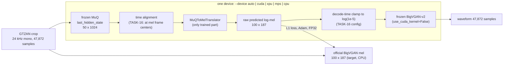

# muq-inversion

Proof-of-concept: can a small HiFi-GAN-style decoder invert MuQ's final time-resolved
representation (`last_hidden_state`) back into recognizable music audio? See `CLAUDE.md` for the
full experimental scope, gates, and reproducibility rules.

## Setup

```bash
uv sync
```

## Gates implemented so far

```bash
uv run python -m muq_inversion.cli doctor --config configs/smoke.yaml       # Gate 0
uv run python -m muq_inversion.cli prepare-data --config configs/smoke.yaml # Gate 1
uv run pytest -q
uv run ruff check .
```

## BigVGAN-v2 memorization test (TASK-15)

Uses NVIDIA's official `nvidia/bigvgan_v2_24khz_100band_256x` code and weights, fetched once at a
pinned revision into the git-ignored `third_party/` directory (no new Python dependencies):

```bash
uv run python scripts/fetch_bigvgan.py                             # ~450 MB, one-time
uv run python scripts/task15_bigvgan_oracle.py                     # positive control
uv run python scripts/train_task15_bigvgan_memorization.py --n 2   # then --n 8
```

TASK-16 reran N=2 with the two TASK-15 audit corrections (MuQ features interpolated at each mel
frame's physical center time; predicted mel clamped to BigVGAN's log floor before decoding),
switched on by its own config. TASK-15's config keeps the original behavior:

```bash
uv run python scripts/train_task15_bigvgan_memorization.py --config configs/task16_bigvgan_corrected.yaml --n 2
uv run python scripts/task16_compare_n2.py                         # TASK-15 vs TASK-16 table
```

`tests/test_bigvgan_common.py` skips its BigVGAN-dependent tests until the fetch has run. Results:
`artifacts/task15_bigvgan_memorization/TASK-15_RESULTS.md` (local) and
`notes/DECISIONS.md#task15-bigvgan-memorization`.

## Running TASK-15/16 on MPS, CUDA, XPU, or CPU

The same scripts run on Apple MPS, NVIDIA CUDA, Intel XPU (e.g. Data Center GPU Max / PVC), and
CPU. Only the device changes; the pipeline doesn't:



**Device selection** (`src/muq_inversion/device.py`, the only module that calls `torch.cuda`,
`torch.xpu`, or `torch.mps`):

- `--device auto` picks CUDA, then XPU, then MPS. If none is available it fails, unless the
  config sets `allow_cpu_fallback: true`.
- An explicit `--device cuda|xpu|mps` fails clearly if that backend is unavailable. It never
  falls back to CPU. `--device cpu` is always allowed.
- `PYTORCH_ENABLE_MPS_FALLBACK=1` is refused, because it moves unsupported MPS ops to the CPU
  silently.
- Everything runs in FP32. There is no autocast and no mixed precision. MuQ and BigVGAN stay
  frozen in eval mode.
- `--device` overrides the config's `device_request`. Every other setting comes from the YAML.
- Requested/resolved device, backend, device name, dtype, torch version, and accelerator
  availability are recorded in the console log, `report.json`, checkpoints, and W&B.
- Checkpoints load onto the CPU first (`map_location="cpu"`), then onto any device.

**Numerical note.** Numerical trajectories need not be bit-identical across MPS, CUDA, XPU, and
CPU. Kernels and reduction orders differ, and small differences compound over 5,000 Adam steps.
The scientific pass criteria (the four TASK-15 memorization criteria, the shuffled-across
control, and listening) are identical on every backend. Compare backends by those criteria, not by
exact loss values.

### Smoke test (bounded, no training)

```bash
uv run python scripts/task15_smoke_test.py --device mps    # Apple Silicon
uv run python scripts/task15_smoke_test.py --device cuda   # NVIDIA
uv run python scripts/task15_smoke_test.py --device cpu
uv run --project envs/xpu python scripts/task15_smoke_test.py --device xpu   # Intel, see below
```

It runs each stage once on the N=2 crops, using the TASK-16 config by default:

- MuQ forward;
- corrected MuQ-to-mel alignment;
- translator forward/backward;
- raw predicted mel;
- decode-time mel-floor clamp;
- BigVGAN inference;
- 3 optimizer steps;
- checkpoint save, then load onto both CPU and the device;
- shuffled-across control.

It writes `artifacts/backend_smoke/<backend>_<UTC timestamp>/report.json` and exits 1 on the first
failing stage. The error names the stage and device. The numbers after 3 steps aren't results.
They only show that every stage runs.

### Full commands per backend

```bash
# Apple MPS (M-series Mac)
uv sync --frozen
uv run python scripts/task15_bigvgan_oracle.py --device mps
uv run python scripts/train_task15_bigvgan_memorization.py --n 2 --device mps
uv run python scripts/train_task15_bigvgan_memorization.py --config configs/task16_bigvgan_corrected.yaml --n 2 --device mps

# NVIDIA CUDA (e.g. BlueHive; see bluehive/run_task15.slurm)
uv sync --frozen
uv run python scripts/task15_bigvgan_oracle.py --device cuda
uv run python scripts/train_task15_bigvgan_memorization.py --n 2 --device cuda

# Intel XPU (Linux x86_64, e.g. ACES PVC)
uv sync --project envs/xpu --frozen
uv run --project envs/xpu python scripts/task15_bigvgan_oracle.py --device xpu
uv run --project envs/xpu python scripts/train_task15_bigvgan_memorization.py --n 2 --device xpu
```

`scripts/fetch_bigvgan.py` must have run once on each machine, because `third_party/` is
git-ignored.

### Environment differences

| Backend | Environment | Notes |
| --- | --- | --- |
| MPS | canonical `pyproject.toml` + `uv.lock` | macOS arm64 PyPI torch wheel. Leave `PYTORCH_ENABLE_MPS_FALLBACK` unset. |
| CUDA | canonical `pyproject.toml` + `uv.lock` | The Linux x86_64 PyPI torch wheel is the CUDA build, and its `nvidia-*` libraries are in the lock. Needs an NVIDIA driver on the node. Determinism flags as in `bluehive/*.slurm`. |
| XPU | `envs/xpu/pyproject.toml` + `envs/xpu/uv.lock` | Same torch version, `2.14.0+xpu`, from `download.pytorch.org/whl/xpu`, plus Intel runtime wheels (`intel-sycl-rt`, `onemkl-*`, `triton-xpu`, ...). Every other package is pinned to the canonical lock's version. Needs the Intel GPU driver (Level Zero) on the node. Linux x86_64 only. |
| CPU | canonical | `--device cpu` explicitly. Slow, but useful for checks. |

The XPU environment is a separate uv project, so the canonical lock never changes for Intel. It
installs this repository editable and gets its own `envs/xpu/.venv`. When the canonical `uv.lock`
changes, regenerate the `constraint-dependencies` list in `envs/xpu/pyproject.toml` from it. Then
run `uv lock --project envs/xpu` and check that only `torch` differs between the two locks.

### ACES PVC smoke-test procedure

Cluster specifics such as partition, GRES name, modules, and paths are **assumptions to check
against the ACES documentation before use**. They have not been tested from this repository.

1. On a login node, install uv if needed (official standalone installer) and clone the repo to
   scratch. Then run:

   ```bash
   export HF_HOME=$SCRATCH/hf_cache UV_CACHE_DIR=$SCRATCH/uv_cache
   uv sync --project envs/xpu --frozen
   uv run --project envs/xpu python scripts/fetch_bigvgan.py
   ```

   The login node needs network access, both for this step and to download the MuQ weights.
   Copy or link `data/raw/gtzan` (git-ignored) so that the N=2 manifest
   (`data/manifests/gate3_scale_2.csv`) resolves.
2. Get an interactive PVC allocation. For example, `srun --partition=pvc --gres=gpu:pvc:1
   --time=00:30:00 --pty bash` (check the partition and GRES names). Then confirm the device is
   visible:

   ```bash
   uv run --project envs/xpu python -c "import torch; print(torch.xpu.is_available(), torch.xpu.get_device_name(0))"
   ```

3. Run the bounded smoke test with `HF_HUB_OFFLINE=1`:

   ```bash
   HF_HUB_OFFLINE=1 uv run --project envs/xpu python scripts/task15_smoke_test.py --device xpu
   uv run --project envs/xpu pytest -q tests/test_device.py tests/test_time_alignment.py
   ```

4. Pass: `PASSED`, and every stage in `report.json` reads `"status": "ok"`. `max_abs_diff_cpu_vs_device`
   should be small, about 1e-5. If a stage fails, `report.json` records the stage, the exception,
   and the operator name. Nothing is retried on the CPU, so record the failure as-is before trying
   a full run.
5. Only after a pass, run the oracle and N=2 commands above with `--device xpu`. Judge the run by
   the same pass criteria as MPS/CUDA.

See `notes/NEXT.md` for current status and the next command to run.
