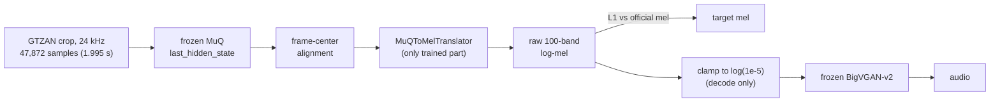

# TASK-18 on ACES: held-out generalization (32/8/8) on one PVC

How to run `tasks/TASK-18.md` on TAMU ACES. The protocol is pre-registered in
`configs/task18_heldout.yaml`; rationale in `notes/DECISIONS.md#task18-heldout-protocol`.



## What the experiment does

| | tracks | crops | used for |
| --- | --- | --- | --- |
| training pool | 32 train | 768 (24 per track, stratified offsets) | training only |
| `memorized` | 32 train | 64 pool crops | fit check (never evidence of invertibility) |
| `train_unseen` | 32 train | 64 reserved windows (9 s, 23 s), never overlapping any pool crop | unseen crops of known tracks |
| `val` | 8 val | 32 (2, 9, 16, 23 s) | checkpoint selection (lowest val mel L1) |
| `test` | 8 test | 32 | evaluated once, after selection |

- **Track selection.** Tracks come from the committed checksum-deduplicated GTZAN split, balanced across genres. Every track whose checksum occurs twice in GTZAN is excluded. Val and test together cover all 10 genres.
- **Manifests.** They are fixed, committed, and hash-checked: `data/manifests/task18_tracks.csv` and `data/manifests/task18_crops.csv`.
- **Training.** 20,000 Adam steps (lr 1e-3) of track-balanced minibatches of 64. Each eval point every 500 steps computes mel metrics on `memorized`, `train_unseen` and `val`. Test is not touched during training.
- **Evaluation.**
  - Applies to the best checkpoint; the final checkpoint gets mel-level metrics only.
  - Computes mel L1 per regime against:
    - BigVGAN's own round trip;
    - `shuffled_across`, `shuffled_time` and `constant_zero` MuQ;
    - a training-set average-mel baseline.
  - Uses a track-clustered bootstrap.
  - Secondary metrics: mel cosine/correlation, variance ratio, RMS and spectral-centroid contour correlation, chroma similarity, and onset correlation at 0/50/200/500 ms smoothing.
- **Outcome.** The pre-registered rule produces `UNDERFIT`, `ALL_FAIL`, `TRACK_SPECIFIC_ONLY`, `HELDOUT_COARSE`, or `HELDOUT_NEAR_ORACLE`. Recognizable audio additionally needs your listening verdict.

## 0. Prepare on a login node (once)

Everything the compute nodes need must be in place first, because they have no network.

```bash
cd /scratch/group/p.ele260080.000/invertibility
git pull                                  # get the TASK-18 code and manifests; commit local edits first
export UV_PROJECT=$PWD/envs/xpu HF_HOME=/scratch/group/p.ele260080.000/hf_cache
module load uv
uv sync --frozen

# Models (already present if TASK-15 ran here)
test -f third_party/bigvgan_v2_24khz_100band_256x/bigvgan_generator.pt || uv run python scripts/fetch_bigvgan.py
uv run python -c "from huggingface_hub import snapshot_download; print(snapshot_download('OpenMuQ/MuQ-large-msd-iter'))"

# Data: the 48 TASK-18 tracks must be in data/raw/gtzan (copy the whole folder from the Mac if not):
#   rsync -av data/raw/gtzan/ <aces-login>:/scratch/group/p.ele260080.000/invertibility/data/raw/gtzan/
uv run python scripts/build_task18_manifests.py --verify-audio
```

The last command must print `"unchanged"` for both manifests and `verified sha256 of 48 WAVs`.

For W&B, compute nodes run offline. Log in once on the login node (`uv run wandb login`) so you can upload afterwards.

## 1. Bounded smoke test (interactive, on a PVC node)

```bash
srun --partition=pvc --gres=gpu:pvc:1 --ntasks=1 --cpus-per-task=8 --mem=32G --time=01:00:00 --pty bash
cd /scratch/group/p.ele260080.000/invertibility
module load uv
bash aces/task18_smoke.sh
```

It stops at the first failure and runs these steps in order:

1. **Backend smoke test.** Every TASK-15 pipeline stage runs on XPU.
2. **Manifest integrity.**
3. **Full TASK-18 code path.** A tiny subset (4/2/2 tracks, 40 steps) goes through training, all controls and metrics, the listening export, the outcome rule, and the report.
4. **Checkpoint/resume equivalence.** It compares two uninterrupted 40-step runs, which give the noise floor, with a run interrupted at step 20 and then resumed.

**Pass:** `=== SMOKE PASSED ===` and `RESUME EQUIVALENCE: PASS` in
`artifacts/task18_smoke/aces_<job>_<time>/ACES_SMOKE_REPORT.md`. Send me that file and `smoke.log`.

The smoke results are **not** a result: the code-path step trains for 40 steps on 4 tracks, so it reports `UNDERFIT`.

On the Mac, resume was bit-identical on single-threaded CPU. With multithreaded CPU and MPS, two identical runs already differ by about 1e-5–1e-4, so the check compares against the measured noise floor instead of requiring zero difference.

## 2. Submit the full run (only when instructed)

```bash
cd /scratch/group/p.ele260080.000/invertibility
git status --short                        # should be clean, so the recorded commit is exact
mkdir -p aces/logs
sbatch aces/run_task18_v1.slurm           # prints the job ID -- note it
```

- **Resources:** 1 PVC (`--gres=gpu:pvc:1`), 1 task, 8 CPUs, 32 GB, 3 h limit, partition `pvc`.
- **Expected time:** well under the limit, about 20–30 min if the PVC is comparable to the M4 Max.
- **Resuming.** The run name is fixed (`task18_heldout_v1`), so resubmitting the same file resumes from `latest.pt` if the job is preempted or runs out of time. SLURM sends TERM 5 minutes before the limit. The script then checkpoints and exits with code 3.
- **No overwriting.** A finished run is never overwritten. Use a new version (`run_task18_v2.slurm` with `RUN_NAME=task18_heldout_v2`) for another run.

Monitor with `squeue -u $USER` and `tail -f aces/logs/muq-task18-heldout-v1-<job>.out`. The log prints a line every 500 steps: mel L1 on memorized/train_unseen/val, the val shuffled-across and average-mel baselines, `*best*` when the val checkpoint improves, and how many training tracks have been visited.

## 3. After the job

```bash
# Record the resources actually used (also printed at the end of the job log):
sacct -j <job> --format=JobID,JobName,Partition,AllocTRES%60,Elapsed,MaxRSS,State
# SUs charged: use the ACES accounting command for project p.ele260080.000 and note the figure.

# Upload W&B (login node; oldest first, so a resumed run's segments append in order):
uv run wandb sync $(ls -d wandb/offline-run-* | sort)
```

Copy back to the Mac:

- `artifacts/task18_heldout/task18_heldout_v1/` (the whole folder, about 40 MB). It contains `report.json`, `TASK-18_RESULTS.md`, `per_example.csv` and `listening/`.
- `runs/task18_heldout/task18_heldout_v1/run_manifest.json`. It records the job ID, SLURM resources, environment, commit, config, hashes, W&B run ID and paths. It's small; the checkpoints can stay on ACES.
- `aces/logs/muq-task18-heldout-v1-<job>.{out,err}`.

```bash
rsync -av <aces-login>:/scratch/group/p.ele260080.000/invertibility/artifacts/task18_heldout/ artifacts/task18_heldout/
rsync -av <aces-login>:/scratch/group/p.ele260080.000/invertibility/runs/task18_heldout/task18_heldout_v1/run_manifest.json runs/task18_heldout/task18_heldout_v1/
rsync -av <aces-login>:/scratch/group/p.ele260080.000/invertibility/aces/logs/ aces/logs/
```

## 4. Listening (blind to nothing but the decision)

`listening/<regime>/` has 24 fixed examples, chosen before training:

- one crop of every val and test track;
- unseen and memorized crops from 4 training tracks.

Each example has `original`, `bigvgan_oracle`, `correct`, `shuffled_across`, `shuffled_time` and `constant_zero` WAVs, plus a mel figure.

Judge `val` and `test` first: is `correct` recognizably the same music as `original`/`oracle`, and clearly closer to it than the three controls? Listening results are recorded; they never choose a checkpoint.

## What to send back

`ACES_SMOKE_REPORT.md` (after step 1). After the full run: the job ID, the `sacct` line, the SUs charged, and the copied folders. I'll write up the results and the outcome classification from `report.json`.
